<div align="center">

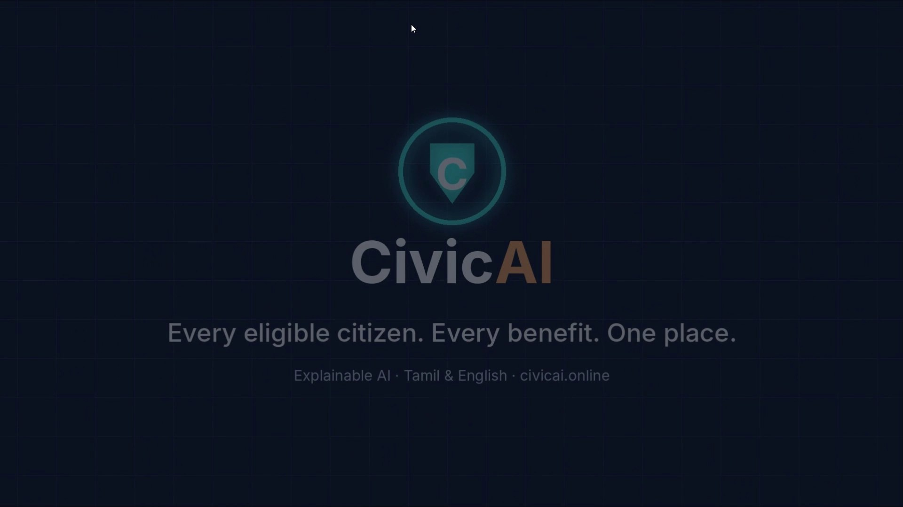

# CivicAI

### India's Responsible AI Government Super App

**Every eligible citizen. Every benefit. One place.**

An AI caseworker that helps Indian citizens find, understand, and apply for government schemes in their own language. Eligibility is decided by a deterministic rule engine, and every answer can be explained, traced to a policy, and audited.

[](https://civicai.online)
[](assets/videos/civicai-full-demo.mp4?raw=true)
[](docs/README.md)


</div>

---

## 📑 Table of Contents

- [Demo Videos](#-demo-videos)
- [The Problem](#-the-problem)
- [Our Solution](#-our-solution)
- [Key Features](#-key-features)
- [Screenshots](#-screenshots)
- [Architecture](#-architecture)
- [How the AI Decides](#-how-the-ai-decides-rule-engine--llm)
- [Tech Stack](#-tech-stack)
- [Project Structure](#-project-structure)
- [Getting Started (Tutorial)](#-getting-started-tutorial)
- [How to Use CivicAI](#-how-to-use-civicai-walkthrough)
- [Documentation](#-documentation)
- [Roadmap](#-roadmap)
- [Team](#-team)

---

## 🎬 Demo Videos

<table>
  <tr>
    <td width="50%" align="center">
      <a href="assets/videos/civicai-intro.mp4?raw=true">
        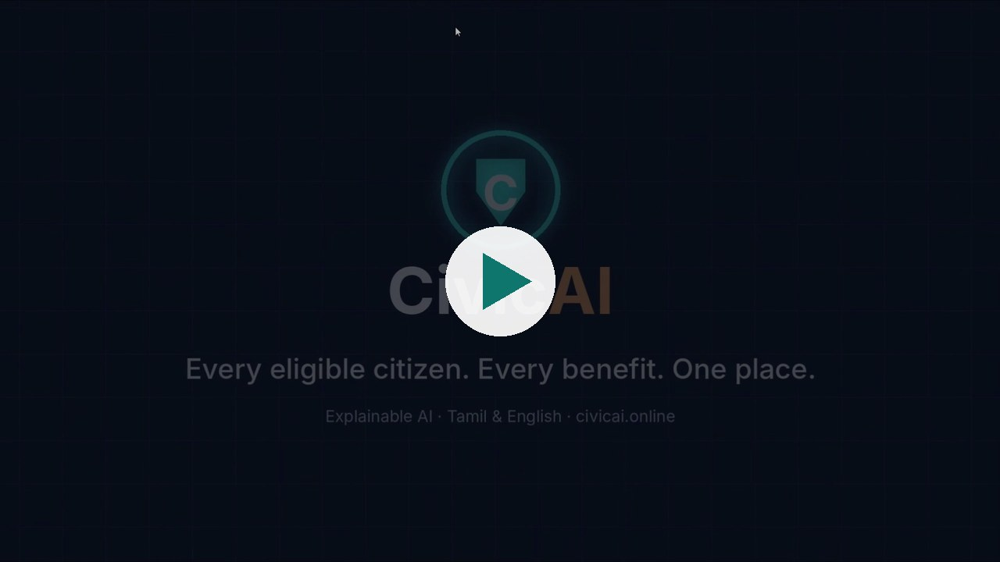
      </a>
      <br /><b>▶️ Intro Trailer</b> (1 min)
    </td>
    <td width="50%" align="center">
      <a href="assets/videos/civicai-full-demo.mp4?raw=true">
        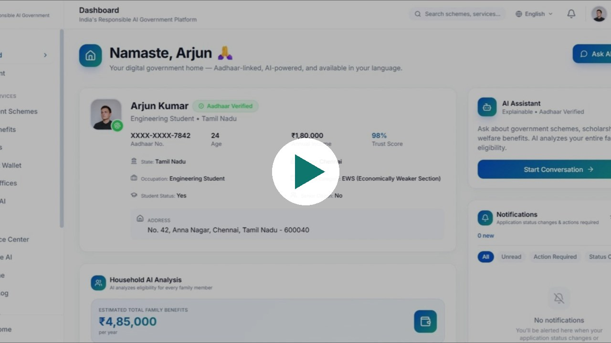
      </a>
      <br /><b>▶️ Full Product Walkthrough</b> (7 min)
    </td>
  </tr>
</table>

<div align="center">
  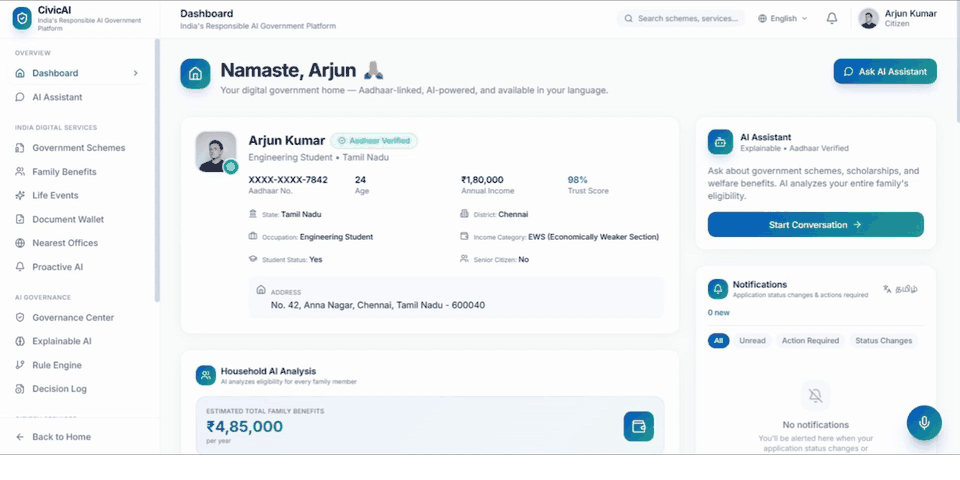
  <br /><sub>Quick tour: Dashboard → AI Assistant → Family Benefits → Schemes → Explainable AI → Proactive AI → Tamil Chat → Document Vault → Risk Dashboard</sub>
</div>

---

## ❗ The Problem

Millions of Indian families never receive government benefits they qualify for, because:

- **They don't know the schemes exist.** India has hundreds of central and state schemes spread across separate portals.
- **Eligibility rules are hard to read.** Income limits, age bands, categories, and document requirements are written in policy language.
- **Language is a barrier.** Most portals are English- or Hindi-first.
- **AI answers can't be trusted blindly.** A chatbot that guesses eligibility could cause real harm to a family.

## 💡 Our Solution

CivicAI is a single citizen app that brings identity, documents, family, and schemes together, with an AI assistant you can trust:

| Principle | How CivicAI delivers it |
|---|---|
| 🧠 **Rule engine decides, AI explains** | A deterministic engine scores eligibility. The LLM can only explain the result and cannot override it. |
| 🔍 **Explainable by default** | Every decision shows the rule matched, documents used, the policy cited, and a confidence score. |
| 👨‍👩‍👧 **Household-first** | Analyses every family member against every scheme at once, not just the person logged in. |
| 🗣️ **Speaks your language** | 13 Indian languages with voice input (speech-to-text) and voice output (text-to-speech). |
| 🛡️ **Governed AI** | Decision log, consent management, risk dashboard, and human review escalation, aligned with NIST AI RMF. |
| 🔔 **Proactive** | The government reaches you first, with alerts for expiring documents, new schemes, and deadlines. |

---

## ✨ Key Features

### Citizen Services
- **AI Caseworker Chat**: Ask in plain language ("I'm a college student") and get matched schemes with benefits, documents, and apply steps.
- **Family Benefits Analysis**: Household-level eligibility across 8 schemes, with total estimated yearly benefit.
- **Government Schemes Catalog**: PM-KISAN, Ayushman Bharat (PM-JAY), PMAY, National Scholarship Portal, IGNOAPS, Beti Bachao Beti Padhao, Stand-Up India, and Skill India (PMKVY), each linked to its official portal.
- **Smart Document Vault**: DigiLocker-style wallet with expiry detection and missing-document alerts.
- **Life Events**: Benefits triggered by life events such as marriage, childbirth, retirement, or starting a business.
- **Nearest Offices**: Map of nearby government service centres (Leaflet).
- **Proactive AI Alerts**: Passport and certificate renewals, new scholarships, and policy changes.
- **Voice First**: Talk to the app and hear the answers back.

### Responsible AI and Governance
- **Explainable AI**: Why this decision, which rule, which documents, which policy, what confidence.
- **Rule Engine Viewer**: Transparent, inspectable eligibility logic.
- **Decision Log**: Audit trail of AI decisions.
- **Consent Management**: Citizen control over data use.
- **AI Risk Dashboard**: Low, medium, and high risk decisions, policy conflicts, and fraud alerts.
- **Policy Intelligence and Predictive Analytics**: Policy change tracking and forecasting.
- **Governance Center**: Transparency, privacy, fairness, and security scorecards.

> ℹ️ **Prototype note:** The AI chat, rule engine, family persistence, notifications, auth, and multilingual UI are live. Aadhaar, DigiLocker, and some governance metrics use realistic **mock data** for now. See [docs/README.md](docs/README.md#features) for the full breakdown.

---

## 📸 Screenshots

<table>
  <tr>
    <td>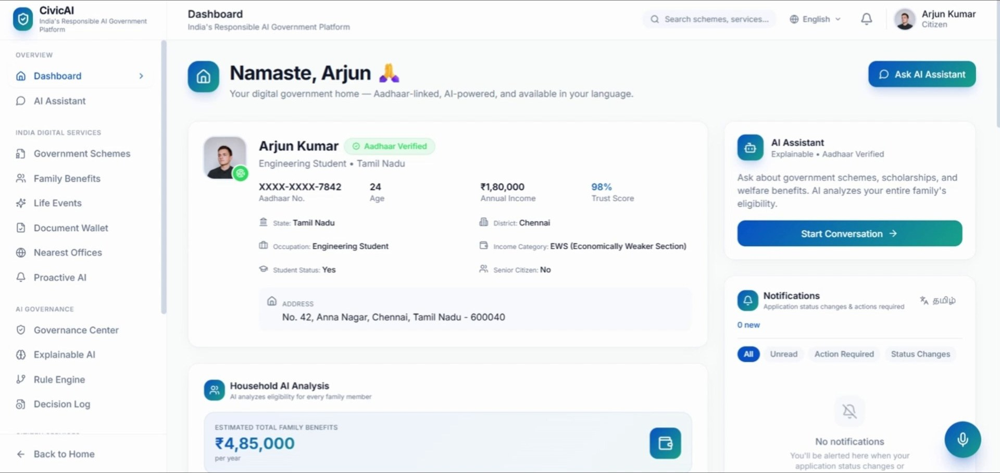<br /><p align="center"><b>Citizen Dashboard</b><br /><sub>Aadhaar-verified profile, household AI analysis, notifications</sub></p></td>
    <td>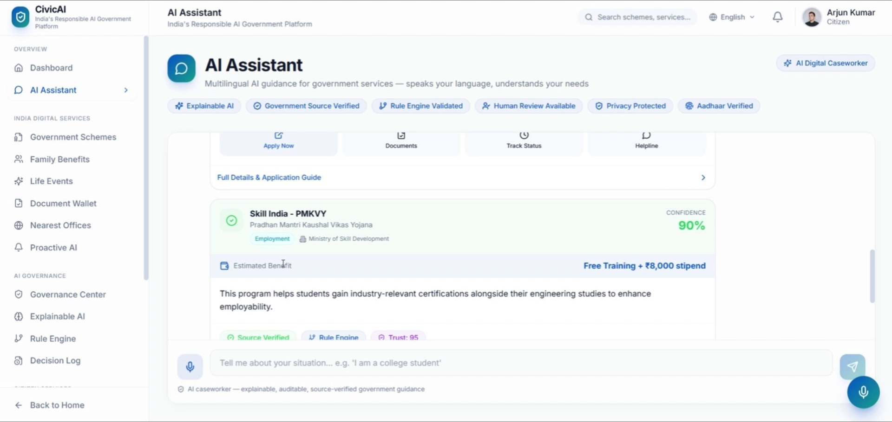<br /><p align="center"><b>AI Assistant</b><br /><sub>Scheme matches with confidence and apply guide</sub></p></td>
  </tr>
  <tr>
    <td>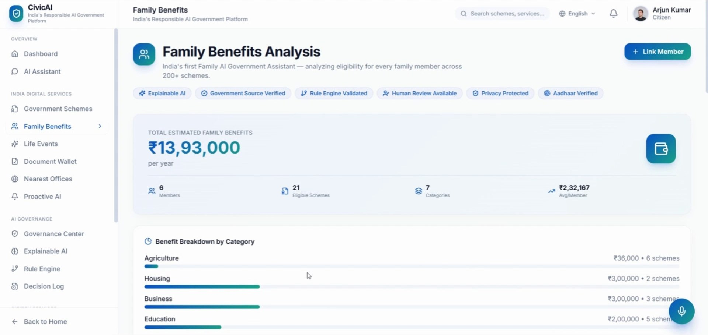<br /><p align="center"><b>Family Benefits Analysis</b><br /><sub>₹13.9L estimated yearly household benefits</sub></p></td>
    <td>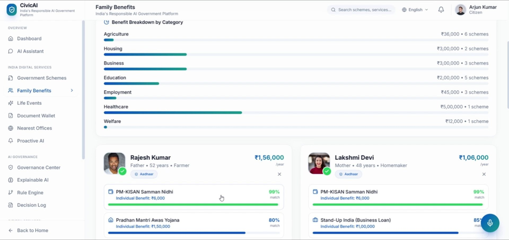<br /><p align="center"><b>Per-Member Eligibility</b><br /><sub>Every member × every scheme</sub></p></td>
  </tr>
  <tr>
    <td>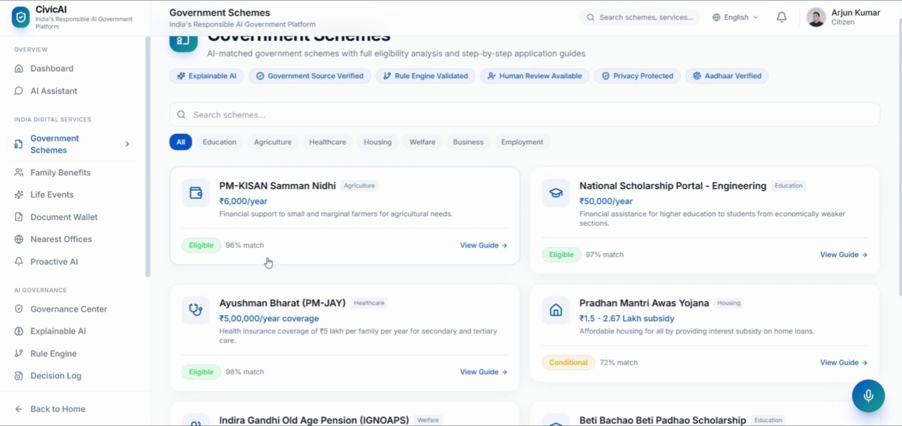<br /><p align="center"><b>Government Schemes</b><br /><sub>AI-matched catalog with category filters</sub></p></td>
    <td>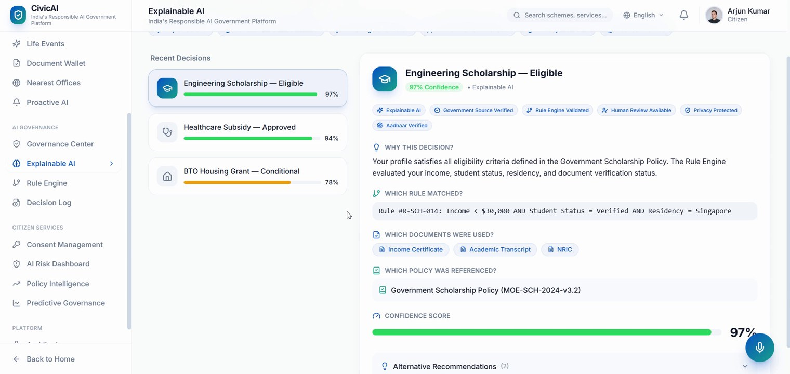<br /><p align="center"><b>Explainable AI</b><br /><sub>Rule, documents, policy, and confidence for every decision</sub></p></td>
  </tr>
  <tr>
    <td>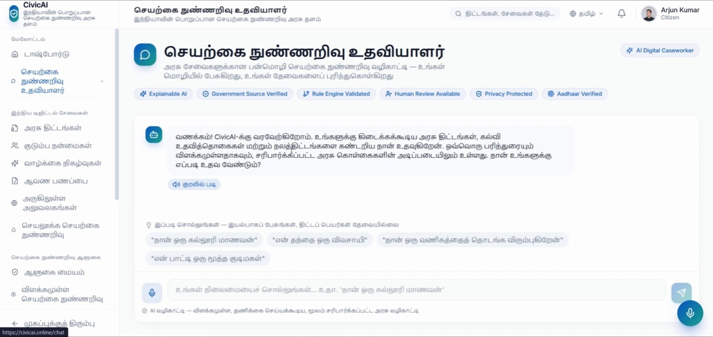<br /><p align="center"><b>Multilingual AI (Tamil)</b><br /><sub>Full UI and AI in the citizen's language</sub></p></td>
    <td>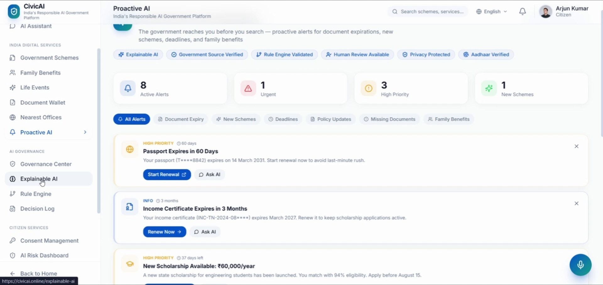<br /><p align="center"><b>Proactive AI</b><br /><sub>Alerts before you even search</sub></p></td>
  </tr>
  <tr>
    <td>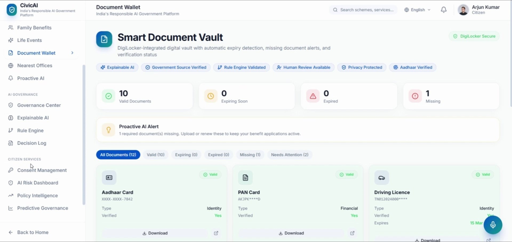<br /><p align="center"><b>Smart Document Vault</b><br /><sub>Expiry detection and missing-document alerts</sub></p></td>
    <td>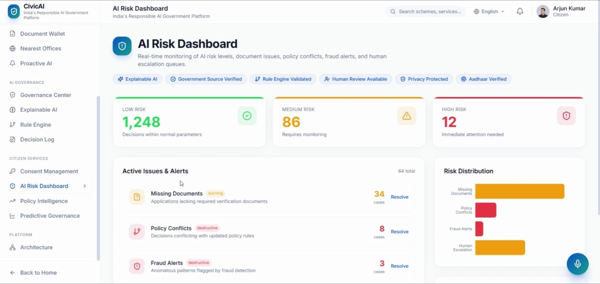<br /><p align="center"><b>AI Risk Dashboard</b><br /><sub>Risk tiers, policy conflicts, fraud alerts</sub></p></td>
  </tr>
</table>

---

## 🏗️ Architecture

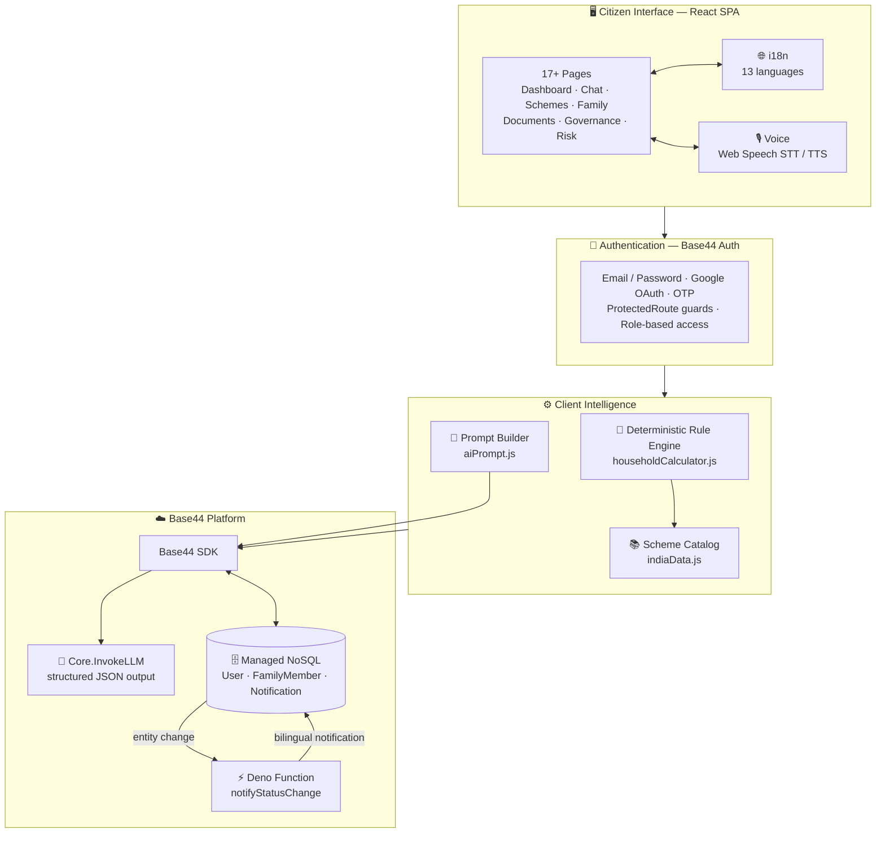

**Hosting:** Base44 Platform with the custom domain [civicai.online](https://civicai.online).
**Full details:** [docs/ARCHITECTURE.md](docs/ARCHITECTURE.md)

---

## 🧠 How the AI Decides: Rule Engine + LLM

> **The Rule Engine decides eligibility. The LLM explains the outcome.**

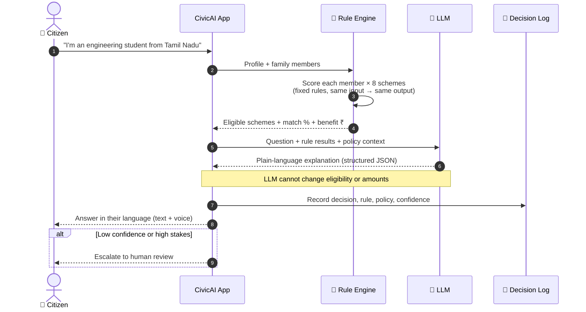

| Without separation | With CivicAI |
|---|---|
| LLM may say "eligible" when the policy says no | Rule engine decides, so the LLM can't override it |
| LLM may make up benefit amounts | Amounts come from the scheme catalog |
| Same question, different answers | Deterministic: same input gives the same result |
| No audit trail | Every decision is traceable to a rule and policy |

**Learn more:** [docs/RULE_ENGINE.md](docs/RULE_ENGINE.md) · [docs/AI.md](docs/AI.md) · [docs/AI_GOVERNANCE.md](docs/AI_GOVERNANCE.md)

---

## 🛠️ Tech Stack

| Layer | Technology |
|---|---|
| **Frontend** | React 18, Vite 6, React Router 6 |
| **Styling / UI** | Tailwind CSS, shadcn/ui (Radix UI), Framer Motion, lucide-react |
| **Data** | @tanstack/react-query, React Context |
| **Charts / Maps** | Recharts, react-leaflet |
| **AI** | Base44 `Core.InvokeLLM` (structured JSON) + deterministic rule engine |
| **Voice** | Web Speech API (STT) + SpeechSynthesis (TTS) |
| **Backend** | Base44 SDK, managed NoSQL entities, Deno serverless functions |
| **Auth** | Base44 Auth: Email/Password, Google OAuth, OTP |
| **Hosting** | Base44 Platform · custom domain `civicai.online` |

---

## 📂 Project Structure

```
civicai/
├── assets/                     # README media
│   ├── screenshots/            # App screenshots
│   ├── team/                   # Team photos
│   └── videos/                 # Intro + full demo videos
├── base44/                     # Base44 backend config
│   ├── config.jsonc            # Build / serve config
│   ├── entities/               # User, FamilyMember, Notification schemas
│   └── functions/              # notifyStatusChange (Deno)
├── docs/                       # Full documentation
│   ├── ARCHITECTURE.md · AI.md · RULE_ENGINE.md · API.md · DATABASE.md
│   ├── SECURITY.md · AI_GOVERNANCE.md · DEPLOYMENT.md · CONTRIBUTING.md
│   ├── audit/                  # 5-part technical audit
│   ├── project/                # Judges deck notes, handover, gov proposal, non-technical guide
│   └── presentation/           # CivicAI_Presentation.pptx
├── src/
│   ├── api/                    # Base44 client
│   ├── components/             # Layout, sidebar, voice, AI cards, shadcn/ui
│   ├── lib/
│   │   ├── householdCalculator.js   # 📏 Rule engine
│   │   ├── aiPrompt.js              # 🧩 LLM prompt builder
│   │   ├── indiaData.js             # 📚 Scheme catalog + citizen data
│   │   ├── i18n.jsx                 # 🌐 13-language translations
│   │   └── AuthContext.jsx          # 🔐 Auth state
│   ├── pages/                  # 24 pages (Dashboard, AIChat, Schemes, Family, …)
│   └── App.jsx                 # Routes
├── .env.example
└── package.json
```

---

## 🚀 Getting Started (Tutorial)

### Prerequisites

- **Node.js 18+** and npm
- A **Base44** account (for the backend). [Sign up](https://base44.com)

### Step 1: Clone and install

```bash
git clone https://github.com/Alvin20082003/civicai.git
cd civicai
npm install
```

### Step 2: Choose how to run

**Option A: Full stack (recommended).** This runs the local Base44 backend and frontend together:

```bash
npm install -g base44@latest
base44 dev
```

Open the frontend URL printed in the terminal.

**Option B: Frontend only, using the hosted backend.**

```bash
cp .env.example .env.local
```

Edit `.env.local`:

```bash
VITE_BASE44_APP_ID=your_app_id
VITE_BASE44_APP_BASE_URL=https://your-app.base44.app
```

Then start Vite:

```bash
npm run dev
```

Open <http://localhost:5173>.

> Without `VITE_BASE44_APP_BASE_URL`, the landing page still loads, but sign-in and AI chat need the backend.

### Step 3: Build for production

```bash
npm run build
npm run preview
```

### Step 4: Publish

Push to `main`, then publish from the Base44 dashboard:

```bash
base44 dashboard open
```

### Useful scripts

| Command | What it does |
|---|---|
| `npm run dev` | Start the Vite dev server |
| `npm run build` | Production build into `dist/` |
| `npm run preview` | Preview the production build |
| `npm run lint` | Lint with ESLint |
| `npm run typecheck` | Type-check with TypeScript (JSDoc) |

---

## 🧭 How to Use CivicAI (Walkthrough)

1. **Sign in** at [civicai.online](https://civicai.online) with email, Google, or OTP.
2. **Pick your language** from the language selector at the top. 13 Indian languages are available.
3. **Dashboard**: See your Aadhaar-verified profile and the estimated yearly benefits for your household.
4. **Ask the AI Assistant**: Type or 🎙️ speak, for example *"I'm a college student"* or *"My father is a farmer"*. You get matched schemes with benefit, confidence, and apply steps.
5. **Family Benefits**: Add family members with **Link Member**. CivicAI evaluates everyone against every scheme.
6. **Explainable AI**: Open any decision to see *why*: the rule matched, the documents used, the policy referenced, and the confidence score.
7. **Document Vault**: Check for expiring or missing documents before you apply.
8. **Proactive AI**: Act on alerts such as renewals, new scholarships, and deadlines.
9. **Governance**: Review the decision log, manage consent, and see risk and fairness metrics.

---

## 📚 Documentation

| Document | Description |
|---|---|
| [Overview](docs/README.md) | Features, maturity, and setup |
| [Architecture](docs/ARCHITECTURE.md) | System design and diagrams |
| [AI Pipeline](docs/AI.md) | LLM integration and prompts |
| [Rule Engine](docs/RULE_ENGINE.md) | Eligibility logic and scoring |
| [API](docs/API.md) | SDK, entities, integrations |
| [Database](docs/DATABASE.md) | Entity schemas and data model |
| [Security](docs/SECURITY.md) | Auth, privacy, data protection |
| [AI Governance](docs/AI_GOVERNANCE.md) | Responsible AI and NIST AI RMF |
| [Deployment](docs/DEPLOYMENT.md) | Hosting and domains |
| [Contributing](docs/CONTRIBUTING.md) | Developer guidelines |
| [Technical Audit](docs/audit/) | 5-part audit report |
| [Project Docs](docs/project/) | Judges presentation, handover, government proposal, non-technical guide |
| [Presentation (PPTX)](docs/presentation/CivicAI_Presentation.pptx) | Slide deck |

---

## 🗺️ Roadmap

- [x] AI caseworker chat with structured output
- [x] Deterministic rule engine (8 schemes)
- [x] Household benefit analysis
- [x] 13-language UI with voice in and out
- [x] Explainable AI, decision log, risk dashboard
- [x] Custom domain: civicai.online
- [ ] Live Aadhaar e-KYC and DigiLocker integration
- [ ] 200+ schemes from an official scheme database
- [ ] RAG over policy documents with a vector database
- [ ] Persistent applications, consent, and audit log entities
- [ ] e-Pramaan / Government SSO
- [ ] Document OCR and a form-filling agent
- [ ] Admin dashboard for government officers

---

## 👥 Team

<table>
  <tr>
    <td></td>
    <td>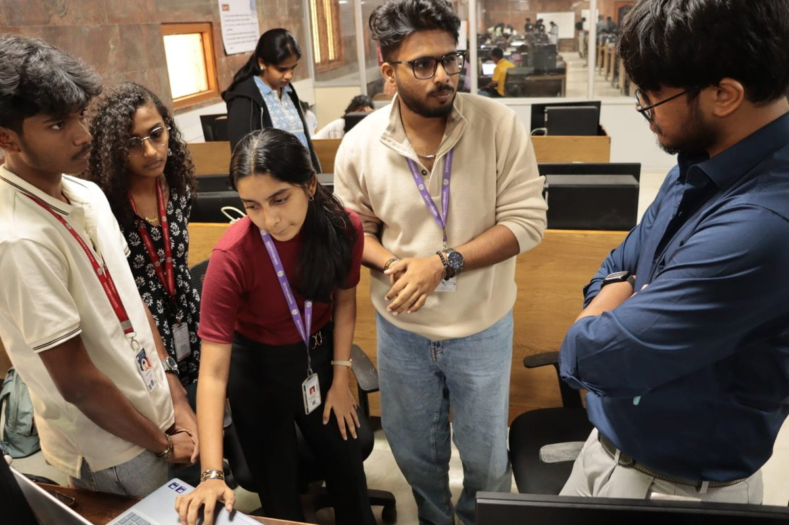</td>
    <td>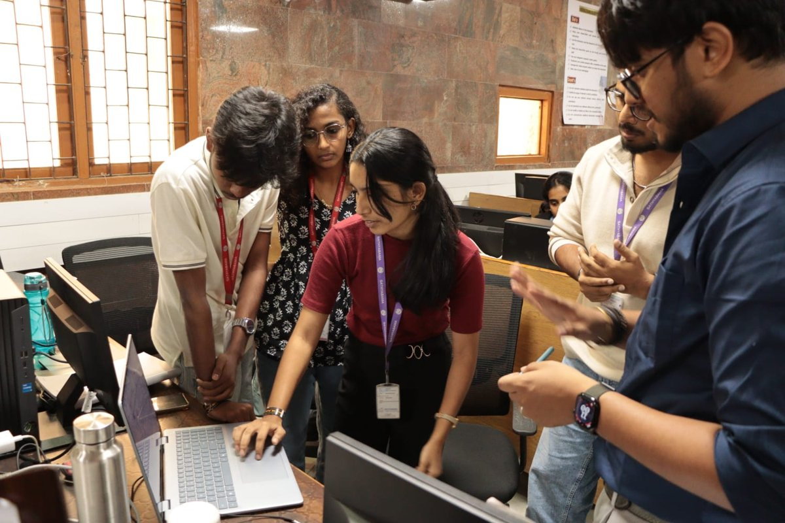</td>
  </tr>
</table>

<p align="center"><i>Team CivicAI presenting the platform</i></p>

---

<div align="center">

**Built with ❤️ for every Indian citizen**

[🌐 civicai.online](https://civicai.online) · [📖 Docs](docs/README.md) · [🎬 Demo](assets/videos/civicai-full-demo.mp4?raw=true)

⭐ If you like this project, give it a star!

</div>
